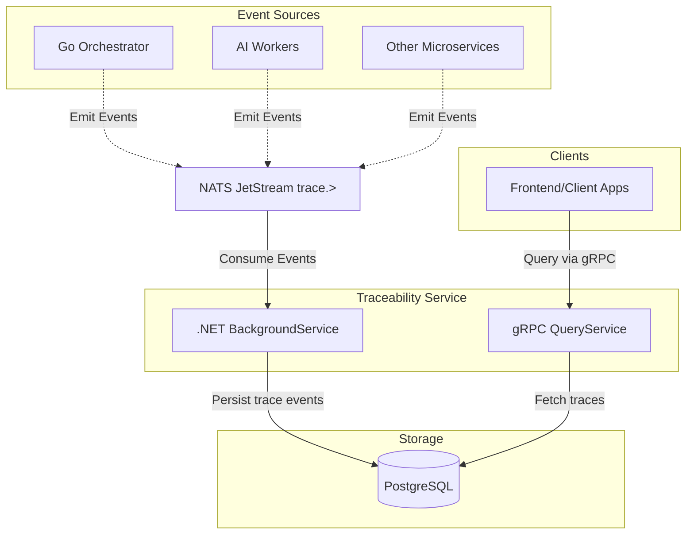

# Traceability Service

Welcome to the **Traceability Service**, a decoupled .NET 10 background worker and gRPC service designed to provide centralized auditing, logging, and traceability across the entire document processing ecosystem.

## Documentation Index

1. **[Core Components](docs/01_Core_Components.md)**  
   Details on NATS JetStream, PostgreSQL persistence, and gRPC querying components.
2. **[How to Implement](docs/02_How_To_Implement.md)**  
   A guide on running the service via Docker or locally on various OS environments.
3. **[Service Communication](docs/03_Service_Communication.md)**  
   Information on gRPC endpoints and the strict No Preemptive Serialization data contract mandate.

---

## High-Level Architecture

